<a href="https://mushcrypto.world/">
  
</a>

<p align="center">
  <a href="https://mushcrypto.world/"></a>
  <a href="https://mushcrypto.world/scorecard/"></a>
  <a href="https://mushcrypto.world/docs/"></a>
  <a href="https://github.com/mushcryptoHQ/node-guides"></a>
  <a href="mailto:hello@mushcrypto.xyz"></a>
</p>

<p align="center">
  <i>MushCrypto watches validator infrastructure the way mycelium reads a forest floor:<br>
  quietly connected, always sensing, never in the way.</i>
</p>

<br>

## 🍄 The network

Every signal is accounted for. MushCrypto runs alongside your validators and reads their vitals continuously, with no dashboards to babysit and no gaps in coverage.


<br>

## 🌱 How we grow

Like mycelium, MushCrypto expands in stages. It starts as a single sensor and grows into a network you can finally see.



<br>

## 🛰️ Networks we secure

Every validator below is live on-chain. Signatures and uptime can be verified independently through each network's native explorer. Click a card to open it.

<p align="center">
  <a href="https://testnet.celestia.explorers.guru/validator/celestiavaloper179yk6hnakly7ggjzjs0kt66h7n7qx9xfcg40dg"></a>
  <a href="https://www.mintscan.io/axelar/validators/axelarvaloper1su3vtc0n3t8mwjt4eu2tugxqc5ym8fe3cpzeyl"></a>
  <a href="https://www.mintscan.io/akash/validators/akashvaloper12z5utc8fc0t4p45mmp34mr683p6ajjdq6qz337"></a>
  <a href="https://ping.pub/shentu/staking/shentuvaloper1y4nfslu4tcp40rjrzrp7adak04fz0fv6ljyy67"></a>
</p>

<details>
<summary><b>Validator addresses</b> (for delegators)</summary>
<br>

| Network | Chain ID | Operator address |
|---|---|---|
| Celestia | `mocha-5` | `celestiavaloper179yk6hnakly7ggjzjs0kt66h7n7qx9xfcg40dg` |
| Axelar | `axelar-dojo-1` | `axelarvaloper1su3vtc0n3t8mwjt4eu2tugxqc5ym8fe3cpzeyl` |
| Akash | `akashnet-2` | `akashvaloper12z5utc8fc0t4p45mmp34mr683p6ajjdq6qz337` |
| Shentu | `shentu-2.2` | `shentuvaloper1y4nfslu4tcp40rjrzrp7adak04fz0fv6ljyy67` |

</details>

<br>

## 🗳️ Governance Scorecard

<a href="https://mushcrypto.world/scorecard/">
  
</a>

<p align="center">
  <a href="https://mushcrypto.world/scorecard/"></a>
  <a href="https://mushcrypto.world/scorecard/osmosis/"></a>
  <a href="https://mushcrypto.world/scorecard/cosmoshub/"></a>
</p>

The Scorecard rebuilds the complete voting record of every bonded validator, covering every vote since mainnet genesis, straight from public chain data.

<table>
  <tr valign="top">
    <td width="33%">
      <h3>🏆 Leaderboard</h3>
      Participation comes first and response speed second. Voting on everything slowly beats voting on half of it quickly.
    </td>
    <td width="33%">
      <h3>📈 Governance momentum</h3>
      Goes proposal by proposal: which ones pulled the whole set in, and which barely registered.
    </td>
    <td width="33%">
      <h3>⚡ Speed vs. consistency</h3>
      Asks whether voting fast also means voting reliably.
    </td>
  </tr>
  <tr valign="top">
    <td>
      <h3>💸 Commission vs. participation</h3>
      Asks whether what a validator charges says anything about whether it shows up.
    </td>
    <td>
      <h3>🧹 Fair scoring</h3>
      Spam and airdrop proposals pulled before voting are excluded.
    </td>
    <td>
      <h3>🔍 Per-validator drill-down</h3>
      Shows the full vote history, response times and the final tally for each proposal.
    </td>
  </tr>
</table>

<a href="https://mushcrypto.world/scorecard/">
  
</a>

<br>

## 📖 Node Docs

This is a field guide for new Celestia node operators, written and maintained by MushCrypto. Click the terminal to dive in.

<a href="https://mushcrypto.world/docs/">
  
</a>

<table>
  <tr>
    <th align="left">🌰 Start here</th>
    <th align="left">⚙️ Running a node</th>
    <th align="left">📡 Operating</th>
  </tr>
  <tr valign="top">
    <td>
      <a href="https://mushcrypto.world/docs/#node-types">Node types explained</a><br>
      <a href="https://mushcrypto.world/docs/#requirements">Hardware &amp; network requirements</a>
    </td>
    <td>
      <a href="https://mushcrypto.world/docs/#light-node">Light node setup</a><br>
      <a href="https://mushcrypto.world/docs/#bridge-node">Bridge / full node setup</a><br>
      <a href="https://mushcrypto.world/docs/#systemd">systemd &amp; auto-restart</a>
    </td>
    <td>
      <a href="https://mushcrypto.world/docs/#monitoring">RPC &amp; metrics</a><br>
      <a href="https://mushcrypto.world/docs/#troubleshooting">Troubleshooting</a><br>
      <a href="https://mushcrypto.world/docs/#glossary">Glossary</a>
    </td>
  </tr>
</table>

<details>
<summary><b>⚡ 30-second light node</b> (mocha testnet)</summary>
<br>

```bash
# initialise the node store
celestia light init --p2p.network mocha

# start sampling, pointed at a consensus RPC
celestia light start --core.ip <consensus-rpc> --p2p.network mocha
```

Before running anything in production, read the full walkthrough in the [docs](https://mushcrypto.world/docs/#light-node), which covers systemd, monitoring and troubleshooting. Cross-check it against the [official Celestia docs](https://docs.celestia.org) too.

</details>

<br>

## 📚 Node Guides

These are the runbooks we use to operate our own validators. Each one goes from a bare server to a signing validator, step by step and copy-paste ready, and is checked against the official docs and the live chain.

<a href="https://github.com/mushcryptoHQ/node-guides">
  
</a>

<p align="center">
  <a href="https://github.com/mushcryptoHQ/node-guides/tree/main/celestia"></a>
  <a href="https://github.com/mushcryptoHQ/node-guides/tree/main/axelar"></a>
  <a href="https://github.com/mushcryptoHQ/node-guides/tree/main/akash"></a>
  <a href="https://github.com/mushcryptoHQ/node-guides/tree/main/shentu"></a>
</p>

| | Network | Chains | Highlights |
|:---:|---|---|---|
| 🟣 | [**Celestia**](https://github.com/mushcryptoHQ/node-guides/tree/main/celestia) | `celestia` · `mocha-5` | Consensus node, validator, **Fibre server**, `x/signal` upgrades |
| ⚪ | [**Axelar**](https://github.com/mushcryptoHQ/node-guides/tree/main/axelar) | `axelar-dojo-1` | **tofnd + vald**, broadcaster proxy, EVM chain maintainers |
| 🔴 | [**Akash**](https://github.com/mushcryptoHQ/node-guides/tree/main/akash) | `akashnet-2` | Binary pinned to the official `meta.json`, `validator.json` flow |
| 🟠 | [**Shentu**](https://github.com/mushcryptoHQ/node-guides/tree/main/shentu) | `shentu-2.2` | State sync, mandatory-upgrade playbook, `validator.json` flow |

<p align="center">
  <a href="https://github.com/mushcryptoHQ/node-guides"><b>📂 Browse all guides → mushcryptoHQ/node-guides</b></a>
</p>

<br>

## ✉️ Ready to see beneath your own network?

Tell us what you run, and we'll show you what MushCrypto catches in the first week.

<p align="center">
  <a href="https://mushcrypto.world/">mushcrypto.world</a>
  &nbsp;·&nbsp;
  <a href="https://mushcrypto.world/scorecard/">Scorecard</a>
  &nbsp;·&nbsp;
  <a href="https://mushcrypto.world/docs/">Docs</a>
  &nbsp;·&nbsp;
  <a href="https://github.com/mushcryptoHQ/node-guides">Node Guides</a>
</p>


